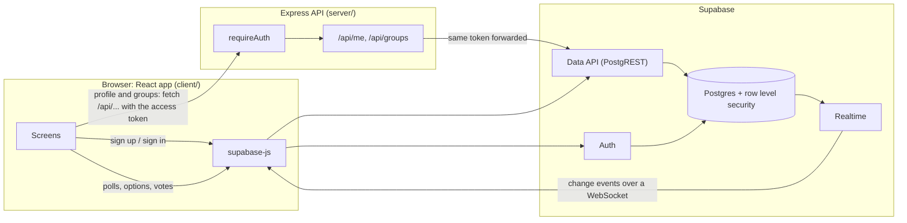

# Architecture

## The big picture

There are three parts: a React app in the browser, a small Express API, and Supabase.



The important idea: **Postgres is the security boundary.** Every query, whether it comes from Express or straight from the browser, runs as the signed-in user, and row level security (RLS) decides which rows that user can see or change. Neither the browser nor Express holds a key that can bypass RLS.

## Two ways the app talks to the database

| | Profile and groups | Polls, options and votes |
| --- | --- | --- |
| Path | Browser → Express `/api` → Supabase | Browser → Supabase directly |
| Client code | `client/src/api.js` | `client/src/polls/repository.js` |
| Why | Express validates input, shapes responses and maps database errors to friendly messages | Poll screens need Realtime, which is a WebSocket between the browser and Supabase, so they read and write there too |
| Who enforces access | RLS (Express forwards the user's token) | RLS |

Both are safe for the same reason: the user's token is what Supabase checks. Express adds convenience, not security.

## A request, step by step

**Creating a group** (through Express):

1. The user submits the form in `Groups.jsx`, which calls `api('/groups', { method: 'POST', body: { name } })`.
2. `api.js` gets the current access token from `supabase.auth.getSession()` and sends it as `Authorization: Bearer <token>`.
3. Vite proxies `/api` to Express. `requireAuth` (`server/auth.js`) verifies the token and attaches `req.user` and `req.supabase`, a Supabase client that carries that token.
4. `routes/groups.js` checks the name and runs `req.supabase.from('groups').insert({ name })`.
5. In Postgres, `created_by` defaults to `auth.uid()`, the insert policy checks it is the caller, and the `groups_add_creator` trigger adds the creator to `group_members` as `admin`.
6. Express returns the new group; the browser navigates to `/groups/<id>`.

**Voting** (direct to Supabase):

1. `PollPage` calls `repository.vote(pollId, optionId)`, which calls the `cast_vote` database function.
2. `cast_vote` locks the poll row, checks the caller is a member, the poll is open and the option belongs to the poll, then inserts or updates the vote.
3. Postgres publishes the change. Supabase Realtime sends it to every subscribed browser whose user is allowed to read that row.
4. Each browser treats the event as "something changed" and re-reads the poll snapshot (`live.js`), so everyone sees counts that came from the database, not from adding up events.

## Where things live

```
client/                     React app (Vite)
  src/main.jsx              App shell: picks a screen from the URL and session; handles invite links
  src/router.js             Tiny client-side router (navigate, usePath, inviteLink)
  src/supabase.js           The one Supabase client for the browser
  src/session.jsx           React context that tracks the Auth session
  src/api.js                fetch wrapper for the Express API (adds the access token)
  src/AuthScreen.jsx        Sign in, sign up, password reset
  src/Groups.jsx            Group list, create/join, group page (members, invite link)
  src/polls/Polls.jsx       Poll list for a group and the live poll page
  src/polls/repository.js   All poll reads/writes and the Realtime subscription
  src/polls/live.js         Keeps a poll snapshot fresh; recovers from missed events
  src/styles.css            All styles

server/                     Express API
  index.js                  Starts the server
  app.js                    Routes, health check, serves the built frontend in production
  auth.js                   requireAuth middleware (verifies Supabase access tokens)
  supabase.js               Creates Supabase clients (one for verifying, one per request)
  errors.js                 Maps database errors to HTTP statuses and messages
  routes/me.js              GET/PATCH the signed-in user's profile
  routes/groups.js          Groups: list, create, join, rename, delete, members, invite link

supabase/
  config.toml               Local Supabase settings (ports, auth options)
  migrations/               The database schema, in order. See docs/database.md

tests/
  polls/*.test.js           Unit tests for repository.js and live.js
  polls/realtime.integration.js   Real Realtime test (local Supabase)
  rls-attacks.test.js       Security and voting tests (local Supabase)
  browser/                  Playwright tests with a fake data source

benchmarks/                 The three performance experiments
```

## Screens and routes

Routing is a few regular expressions in `client/src/main.jsx`:

| Path | Screen |
| --- | --- |
| `/` | Your groups, create a group, join a group |
| `/groups/<id>` | Members, invite link, the group's polls |
| `/polls/<id>` | One poll: live results, vote, suggest, close |
| `/join/<code>` | Remembers the invite, signs you in if needed, joins, then opens the group |
| `/reset-password` | Choose a new password after opening a reset email |

Signed-out users always see the sign-in screen. An invite code is kept in `localStorage` so it survives sign-up and the email confirmation round trip.

## Express API

Every route except `/api/health` requires `Authorization: Bearer <access token>`.

| Method and path | Purpose | Notes |
| --- | --- | --- |
| `GET /api/health` | Is the API up and can it reach Supabase? | No sign-in needed |
| `GET /api/me` | The signed-in user's profile | |
| `PATCH /api/me` | Change `username` and/or `display_name` | Max 60 characters each |
| `GET /api/groups` | Groups I belong to, with my role and member count | |
| `POST /api/groups` | Create a group (`{ name }`) | I become its admin |
| `POST /api/groups/join` | Join with an invite code or a full link (`{ code }`) | |
| `GET /api/groups/:id` | One group with its members | 404 if I am not a member |
| `PATCH /api/groups/:id` | Rename | Admins only |
| `DELETE /api/groups/:id` | Delete the group and everything in it | Admins only |
| `POST /api/groups/:id/invite` | Replace the invite code | Admins only; old links stop working |
| `DELETE /api/groups/:id/members/:userId` | Remove a member; `me` leaves the group | Admins can remove others |

Errors come back as `{ "error": "message for the user", "code": "database error code" }`. `server/errors.js` holds the mapping.

## Design decisions worth knowing

- **Express never uses the secret key.** It verifies the user's token and forwards it, so a bug in a route cannot leak another group's data: Postgres would refuse.
- **Routes do not check membership themselves.** They ask for the row; RLS returns nothing if you are not allowed, and the route turns that into 404 or 403.
- **Votes are written only through `cast_vote`.** Direct inserts and updates on `votes` are revoked, which is what makes "no vote counts after the poll closes" a guarantee instead of a hope.
- **The winner is chosen in the database** by `close_poll` and saved on the poll. The UI only displays `saved_outcome_option_id`.
- **Realtime events are signals, not data.** The UI re-reads a full snapshot instead of trusting event payloads, which keeps counts correct after reconnects, missed events and deletes.

## Known limitations

- Polls cannot be deleted or reopened from the UI (the database allows the creator or a group admin to delete one).
- If a group's only admin leaves, nobody can rename, delete or re-key the group.
- There is no profile screen: `PATCH /api/me` exists, but nothing in the UI calls it yet.
