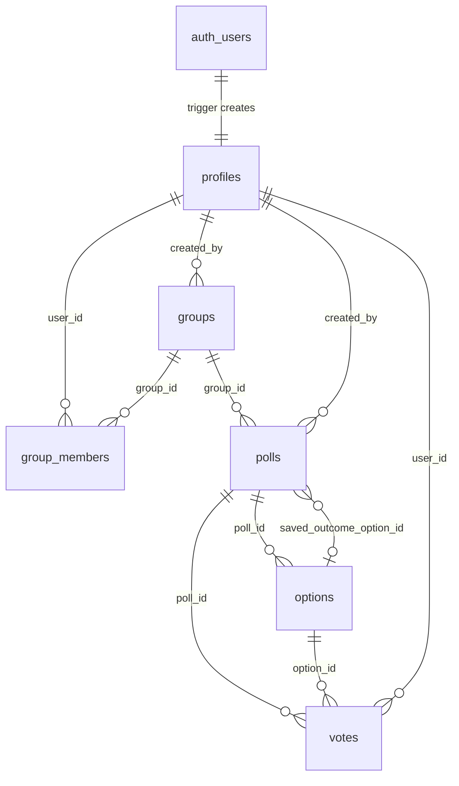

# Database reference

Everything here is defined in `supabase/migrations/`. For the ideas behind it (what RLS is, why some actions are functions), read [supabase.md](supabase.md) first.

## Tables

`auth.users` belongs to Supabase Auth. Everything else is in the `public` schema.

### `profiles`

One row per user, created by the `on_auth_user_created` trigger when someone signs up.

| Column | Type | Notes |
| --- | --- | --- |
| `id` | uuid, primary key | Same id as `auth.users`; deleted with the auth user |
| `username` | text, unique | May be empty |
| `display_name` | text | |
| `created_at` | timestamptz | |

### `groups`

| Column | Type | Notes |
| --- | --- | --- |
| `id` | uuid, primary key | |
| `name` | text | Cannot be blank |
| `created_by` | uuid → `profiles` | Defaults to `auth.uid()`. A user who created a group cannot be deleted until the group is |
| `invite_code` | text, unique | 32 random hex characters, generated by the database |
| `created_at` | timestamptz | |

Inserting a group fires the `groups_add_creator` trigger, which adds the creator to `group_members` as `admin`.

### `group_members`

| Column | Type | Notes |
| --- | --- | --- |
| `group_id` | uuid → `groups` | Primary key together with `user_id`; deleted with the group |
| `user_id` | uuid → `profiles` | |
| `role` | text | `admin` or `member` |
| `joined_at` | timestamptz | |

### `polls`

| Column | Type | Notes |
| --- | --- | --- |
| `id` | uuid, primary key | |
| `group_id` | uuid → `groups` | Deleted with the group |
| `created_by` | uuid → `profiles` | Defaults to `auth.uid()` |
| `question` | text | Cannot be blank |
| `status` | text | `open` or `closed` |
| `saved_outcome_option_id` | uuid → `options` | The winner, set by `close_poll()`. Null while open, or if nobody voted. Must be an option of this same poll |
| `created_at` | timestamptz | |

### `options`

A restaurant suggested in a poll.

| Column | Type | Notes |
| --- | --- | --- |
| `id` | uuid, primary key | |
| `poll_id` | uuid → `polls` | Deleted with the poll |
| `restaurant_name` | text | Cannot be blank |
| `price_range` | text | Optional (`$` to `$$$$` in the UI) |
| `food_category` | text | Optional |
| `created_at` | timestamptz | Used to break ties |

### `votes`

| Column | Type | Notes |
| --- | --- | --- |
| `id` | uuid, primary key | |
| `poll_id`, `option_id` | uuid → `options (poll_id, id)` | The pair is one foreign key, so a vote can only point at an option of its own poll |
| `user_id` | uuid → `profiles` | Defaults to `auth.uid()` |
| `created_at` | timestamptz | Updated when the vote changes |

`unique (poll_id, user_id)` enforces one vote per person per poll. Changing your vote updates the row.

## Rules the database enforces by itself

These hold no matter what any client sends:

- One vote per user per poll (`votes_one_per_user_per_poll`).
- A vote's option belongs to the vote's poll (`votes_option_must_belong_to_poll_fk`).
- A poll's saved winner is one of its own options (`polls_saved_outcome_belongs_to_poll_fk`).
- Names and questions are not blank; `role` and `status` hold only their allowed values.
- A group's creator is always a member with role `admin` at creation.
- No vote is inserted or changed after a poll is closed (`cast_vote` and `close_poll` lock the poll row).

## Grants

What the `authenticated` role may do at all, before policies are considered. `anon` has no privileges.

| Table | Select | Insert (columns) | Update (columns) | Delete |
| --- | --- | --- | --- | --- |
| `profiles` | yes | no | `username`, `display_name` | no |
| `groups` | yes | `name` | `name` | yes |
| `group_members` | yes | no | no | yes |
| `polls` | yes | `group_id`, `question` | no | yes |
| `options` | yes | `poll_id`, `restaurant_name`, `price_range`, `food_category` | no | no |
| `votes` | yes | no | no | no |

## Policies

All policies apply to the `authenticated` role.

| Table | Policy | Command | Allowed when |
| --- | --- | --- | --- |
| `profiles` | read self and group peers | select | It is you, or you share a group |
| `profiles` | update self | update | It is you |
| `groups` | members read | select | You are a member, or you created it |
| `groups` | create as self | insert | `created_by` is you |
| `groups` | admins update | update | You are an admin of it |
| `groups` | admins delete | delete | You are an admin of it |
| `group_members` | members read roster | select | The row's group is one of yours |
| `group_members` | leave or admin removes | delete | The row is yours, or you are an admin of the group |
| `polls` | members read | select | The poll's group is one of yours |
| `polls` | members create | insert | `created_by` is you and the group is one of yours |
| `polls` | creator or admin deletes | delete | You created it, or you are an admin of its group |
| `options` | members read | select | The option's poll is in one of your groups |
| `options` | members suggest while open | insert | The poll is open and in one of your groups |
| `votes` | members read | select | The vote's poll is in one of your groups |

`votes` also has insert, update and delete policies ("cast own while open", "change own while open", "remove own while open") from the original design. They no longer have any effect, because the voting migration revoked those grants so that every vote goes through `cast_vote()`.

"Members read" on `groups` includes the creator because `insert ... returning` checks the read policy before the trigger has added the membership row.

## Functions

### Callable through the API

| Function | Returns | Rules | Errors |
| --- | --- | --- | --- |
| `join_group(p_invite_code text)` | group id | Signed in. Joining twice is harmless | `P0002` unknown code |
| `rotate_group_invite(p_group_id uuid)` | new code | Group admin | `42501` not an admin |
| `cast_vote(p_poll_id uuid, p_option_id uuid)` | nothing | Member of the poll's group; poll open; option belongs to poll. Inserts or changes your vote | `P0002` no such poll, `42501` not a member, `55000` poll closed, `22023` wrong option |
| `close_poll(p_poll_id uuid)` | winning option id or null | Poll creator. Closing an already closed poll returns the saved winner | `P0002` no such poll, `42501` not the creator |
| `get_vote_totals(p_poll_id uuid)` | `option_id`, `restaurant_name`, `vote_count` per option | Member of the poll's group | `42501` otherwise |

**How the winner is chosen:** most votes; ties go to the option suggested first (`created_at`), then to the smaller id. If nobody voted, there is no winner and `saved_outcome_option_id` stays null.

### Internal

| Function | Purpose |
| --- | --- |
| `public.handle_new_user()` | Trigger function: creates the `profiles` row on sign-up |
| `private.add_group_creator()` | Trigger function: makes a group's creator its admin |
| `private.my_group_ids()` | Group ids the caller belongs to |
| `private.my_poll_ids()` | Poll ids in the caller's groups |
| `private.my_peer_ids()` | User ids that share a group with the caller |
| `private.is_group_admin(group_id)` | Is the caller an admin of this group? |
| `private.is_open_poll_in_my_group(poll_id)` | Is this poll open and in one of the caller's groups? |

## Indexes

Besides primary keys and unique constraints:

| Index | Supports |
| --- | --- |
| `group_members_user_id_idx (user_id, group_id)` | "Which groups am I in?", used by almost every policy |
| `polls_group_id_idx (group_id)` | Listing a group's polls |
| `votes_poll_option_idx (poll_id, option_id) include (id)` | Counting votes per option |

## Realtime

`polls`, `options` and `votes` are in the `supabase_realtime` publication. `groups`, `group_members` and `profiles` are not, so the group screens do not update live.
